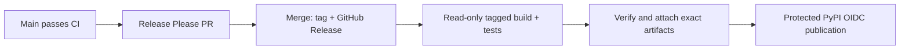

# Contributing

## Develop and validate

Use Python 3.11–3.14 and an activated virtual environment:

```sh
python -m pip install -e '.[dev,example,cimd]'
python -m pip check
python -m pytest --cov --cov-report=term-missing
python -m ruff check .
python -m ruff format --check .
python -m mypy src
python -m bandit -q -r src examples
python -m pip_audit
python scripts/check_docs.py
python -m build
python -m twine check --strict dist/*
python scripts/publication_gate.py
python scripts/check_distribution.py dist
```

Protocol changes need observable HTTP/API regression tests, negative cases and transaction rollback/concurrency coverage. Exercise real Authlib grants/endpoints through public hooks; do not vendor or patch upstream implementations. Follow the [integration boundaries](docs/integration.md#implementation-boundaries) and [storage contract](docs/storage.md).

Use Conventional Commits (`feat`, `fix`, `docs`, `ci`, `chore`). Keep temporary investigation notes, audit reports, fixtures and logs under ignored `artifacts/`. Public docs should explain supported behavior and operational requirements.

## CI and security

CI tests Python 3.11–3.14, minimum/latest compatible dependency profiles, a 90% coverage floor, lint, formatting, strict typing, Bandit, pip-audit, distribution metadata and installed-wheel behavior. Release checks reuse CI. Weekly runs catch newly disclosed dependency issues.

The `Trivy security gate` uses checksum-pinned Trivy 0.76.2, resolves runtime/optional/development dependencies and checks them against the updated database. It also scans repository secrets and supported misconfigurations. HIGH/CRITICAL findings, unfixed vulnerabilities and scanner/database failures fail the job. Configure required checks in branch protection to block merges.

With Trivy installed, these POSIX shell commands reproduce the gate:

```sh
mkdir -p artifacts/security-scan
python -m pip freeze --exclude oauth21-asgi > artifacts/security-scan/requirements.txt
trivy fs --scanners vuln --severity HIGH,CRITICAL --exit-code 1 --ignorefile /dev/null artifacts/security-scan/requirements.txt
trivy fs --scanners secret,misconfig --severity HIGH,CRITICAL --exit-code 1 --ignorefile /dev/null --skip-dirs .git --skip-dirs .tools --skip-dirs artifacts --skip-dirs '.venv*' --skip-dirs dist --skip-dirs build .
```

On Windows use an empty existing file instead of `/dev/null`. Store reports locally under `artifacts/security-scan/`; do not commit secrets or investigation output. Scanners complement protocol review rather than establish full deployment security.

## Installed-wheel integration

```sh
python scripts/e2e.py dist/oauth21_asgi-VERSION-py3-none-any.whl
python scripts/e2e.py dist/oauth21_asgi-VERSION-py3-none-any.whl --https
python scripts/e2e.py dist/oauth21_asgi-VERSION-py3-none-any.whl --https --mcp
```

Each command installs the wheel in an environment outside the checkout and launches Uvicorn and an independent client in all three client modes. HTTPS uses Caddy 2.11.9 through `CADDY_BINARY` with an explicitly trusted temporary CA. CI downloads checksum-pinned Caddy. The MCP layer uses official Python SDK 2.3.0 for tool calls and cross-resource rejection; it is not a runtime dependency or hosted-client certification.

For the smaller smoke test, install the wheel plus `fastapi`, `itsdangerous` and `httpx2` into a clean environment, change outside the checkout, then run `python /absolute/repo/scripts/wheel_smoke.py /absolute/repo`.

## Releases and PyPI

`src/oauth21_asgi/_version.py` is the authoritative version. Release Please updates it, CHANGELOG.md and its manifest in a release PR. Review that PR before merging; do not hand-edit release history just to prepare a change.



The tagged build creates wheel/sdist once, checks metadata and a complete SHA256SUMS manifest, and tests that exact wheel. A separate attachment job downloads its immutable artifact ID and verifies checksums before writing release assets. Existing assets are never overwritten. Publication requires successful checks/attachment, a stable version tag and an existing published GitHub Release; it downloads validated assets rather than rebuilding.

Maintainer setup:

1. Configure a PyPI Trusted Publisher for `oauth21-asgi`, owner `karusb`, repository `oauth21-asgi`, workflow `release-please.yml`, environment `pypi`.
2. Create the GitHub `pypi` environment with appropriate reviewers and set repository variable `PYPI_PUBLISH=true` when publication is intended. The publication job alone has OIDC permission and enables attestations; no PyPI API token is required.
3. Allow GitHub Actions to create release PRs, or supply a suitably scoped `RELEASE_PLEASE_TOKEN` if automation must trigger downstream workflows. Restrict branch/tag and release-asset writes.

After a release has validated assets, manually dispatch Release with `release_tag=vMAJOR.MINOR.PATCH` to retry publication. This cannot rebuild, overwrite assets or republish an existing PyPI version. Releases without the required manifest cannot use the retry path. Investigate incomplete attachment instead of replacing artifacts silently.

## Dependency licenses

The package is BSD-3-Clause. Dependencies are installed separately and retain their own licenses: [Authlib](https://github.com/authlib/authlib/blob/v1.9.5/LICENSE) and [Starlette](https://github.com/Kludex/starlette/blob/1.10.0/LICENSE.md) are BSD-3-Clause; [python-multipart](https://github.com/Kludex/python-multipart/blob/0.0.33/LICENSE.txt) is Apache-2.0. Redistributing dependencies requires preserving their applicable notices and license terms. Check optional dependencies as part of your own distribution.
