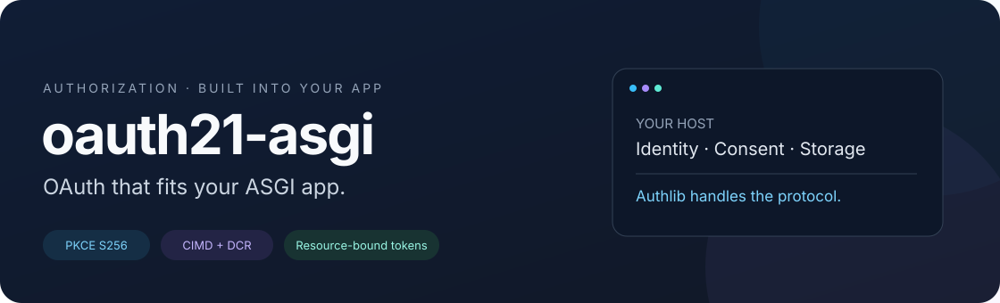
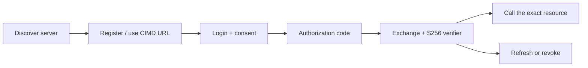

<div align="center">



**Your login. Your consent. OAuth powered by Authlib.**

[](https://github.com/karusb/oauth21-asgi/actions/workflows/ci.yml)
[](https://github.com/karusb/oauth21-asgi/releases)

[](https://github.com/karusb/oauth21-asgi/blob/main/LICENSE)

[Get started](https://github.com/karusb/oauth21-asgi/blob/main/docs/getting-started.md) · [Integration](https://github.com/karusb/oauth21-asgi/blob/main/docs/integration.md) · [CIMD](https://github.com/karusb/oauth21-asgi/blob/main/docs/cimd.md) · [Standards](https://github.com/karusb/oauth21-asgi/blob/main/docs/standards.md)

</div>

Embed an **OAuth Authorization Server** in Starlette or FastAPI without replacing your application's identity system. Give public clients scoped, resource-bound access through Authorization Code + PKCE, with optional **Client ID Metadata Documents (CIMD)** and **Dynamic Client Registration (DCR)**.

## Built for your application

| | Capability | What it gives you |
| --- | --- | --- |
| 🔐 | **PKCE, always** | Mandatory S256, short-lived single-use codes and exact registered redirects |
| 🌐 | **Three client modes** | DCR only, CIMD only, or both — with no fallback from failed CIMD to DCR |
| 🎯 | **One token, one resource** | Exact audience binding and scope checks at authorization, exchange, refresh and validation |
| 🔄 | **A complete token lifecycle** | Refresh rotation, replay-family revocation, absolute grant lifetimes and token revocation |
| 🧩 | **Your host stays in control** | Identity, consent and transactional storage contracts; account-version invalidation |
| 🛡️ | **Bounded metadata fetching** | Verified TLS, vetted DNS, no redirects and bounded cache/response/in-flight work |

## Start small

```sh
python -m pip install 'oauth21-asgi[fastapi] @ git+https://github.com/karusb/oauth21-asgi.git'
```

The GitHub installation requires Git. For a checkout or other extras, see [installation](https://github.com/karusb/oauth21-asgi/blob/main/docs/getting-started.md).

Mount it with your own adapters:

```python
from fastapi import FastAPI
from oauth21_asgi import AuthorizationServer, ExactRedirectPolicy

app = FastAPI()
oauth = AuthorizationServer(
    issuer="https://auth.example.com/",
    scopes={"read", "write"},
    resources={"https://api.example.com/documents"},
    storage=storage,  # Your durable Storage adapter
    identity=identity,  # Your Identity adapter
    consent=consent,  # Your Consent adapter
    redirect_policy=ExactRedirectPolicy({"https://client.example.com/callback"}),
)
oauth.mount(app)
```

`storage`, `identity` and `consent` are supplied by your application. The [integration guide](https://github.com/karusb/oauth21-asgi/blob/main/docs/integration.md) explains each contract; the [runnable demo](https://github.com/karusb/oauth21-asgi/blob/main/examples/fastapi_app.py) shows them together.

**Want to try it first?** Follow the [local demo walkthrough](https://github.com/karusb/oauth21-asgi/blob/main/docs/getting-started.md#try-the-included-demo). MemoryStorage and the demo login are development fixtures.

## Meet your clients where they are

| Mode | Client identity | Outbound metadata requests |
| --- | --- | --- |
| **`DCR_ONLY`** — default | Public registration, random client IDs | None |
| **`CIMD_ONLY`** | HTTPS client metadata document URLs | Enabled; registration route absent |
| **`CIMD_AND_DCR`** | Both populations, separate resolution paths | For CIMD clients only |

Install the `fastapi,cimd` extras and enable CIMD with `client_mode=ClientMode.CIMD_ONLY` or `ClientMode.CIMD_AND_DCR`, and `cimd=ClientMetadataDocuments()`. See [configuration, network policy and migration](https://github.com/karusb/oauth21-asgi/blob/main/docs/cimd.md).



## A focused security profile

**Public clients, opaque tokens, explicit consent.** Request bounds, digested credentials at rest, browser-bound one-use consent and fresh account-version checks protect the integration boundary. Hosts provide production login/session security, durable storage, resource-server challenges and rate limits.

This is an ASGI library, not a complete identity provider or an MCP server. It can serve as the Authorization Server for an MCP host; the host/SDK owns protected-resource discovery and tool authentication. Installed-wheel tests exercise TCP, verified HTTPS and the official Python MCP SDK in all client modes.

**Scope:** no confidential-client authentication, OIDC, JWT access tokens or token introspection. No OAuth/MCP/hosted-client certification is claimed. See [security responsibilities](https://github.com/karusb/oauth21-asgi/blob/main/SECURITY.md).

## Standards, with the boundaries documented

Implements a public-client profile of **RFC 6749**, **6750**, **7636**, **7009**, **7591**, **8414**, **8707** and **9207**, with relevant **RFC 9700** controls. OAuth 2.1 and CIMD are draft references. Registration defaults, code-replay handling and other incomplete behavior are listed in the [standards coverage guide](https://github.com/karusb/oauth21-asgi/blob/main/docs/standards.md); the package name is not a blanket compliance claim.

## Go deeper

| Guide | What you will find |
| --- | --- |
| [Get started](https://github.com/karusb/oauth21-asgi/blob/main/docs/getting-started.md) | Installation choices, demo and troubleshooting |
| [Integration](https://github.com/karusb/oauth21-asgi/blob/main/docs/integration.md) | Host adapters, client flow, resource validation and internals |
| [CIMD](https://github.com/karusb/oauth21-asgi/blob/main/docs/cimd.md) | Modes, metadata validation, SSRF policy, caching and migration |
| [Storage](https://github.com/karusb/oauth21-asgi/blob/main/docs/storage.md) | Transaction guarantees, records and adapter conformance |
| [Standards](https://github.com/karusb/oauth21-asgi/blob/main/docs/standards.md) | Implemented RFC behavior, restrictions and gaps |
| [Contributing](https://github.com/karusb/oauth21-asgi/blob/main/CONTRIBUTING.md) | Local checks, CI and release/PyPI setup |
| [Changelog](https://github.com/karusb/oauth21-asgi/blob/main/CHANGELOG.md) | Release history |

## License

[BSD-3-Clause](https://github.com/karusb/oauth21-asgi/blob/main/LICENSE). Authlib, Starlette and optional dependencies retain their own licenses; no upstream source is vendored. See [dependency license obligations](https://github.com/karusb/oauth21-asgi/blob/main/CONTRIBUTING.md#dependency-licenses).
