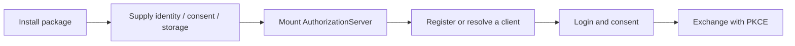

# Installation & first run

[← Overview](../README.md) · [Host integration](integration.md) · [CIMD](cimd.md)

## Choose your installation

Python **3.11–3.14** is tested. Use a virtual environment.

The package is currently distributed through GitHub releases/source; the PyPI publication workflow is prepared separately. Start from a checkout:

```sh
git clone https://github.com/karusb/oauth21-asgi.git
cd oauth21-asgi
```

| Your application | Install from the checkout |
| --- | --- |
| Starlette / ASGI, DCR only | `python -m pip install .` |
| FastAPI, DCR only | `python -m pip install '.[fastapi]'` |
| FastAPI with CIMD fetching | `python -m pip install '.[fastapi,cimd]'` |
| Demo and development tools | `python -m pip install -e '.[dev,example,cimd]'` |

For a direct GitHub install without a working checkout (requires Git):

```sh
python -m pip install 'oauth21-asgi[fastapi,cimd] @ git+https://github.com/karusb/oauth21-asgi.git'
```

This follows `main`; use `@vMAJOR.MINOR.PATCH` on the Git URL for a released source tag. After a distribution is published to PyPI, `python -m pip install 'oauth21-asgi[fastapi,cimd]'` selects the published package instead. Release setup is documented in [Contributing](../CONTRIBUTING.md#releases-and-pypi).

Extras are additive: `fastapi` adds FastAPI, `cimd` adds aiohttp, and `example` adds FastAPI, Uvicorn and session support. The package has no database driver or MCP runtime dependency. `dev` installs repository checks and build tools.

<details>
<summary><strong>Create a virtual environment</strong></summary>

```sh
python -m venv .venv
```

Activate it on macOS/Linux with `source .venv/bin/activate`, or in Windows PowerShell with `.venv\Scripts\Activate.ps1`. Then use the installation command above. Quoted extras work in both shells.

</details>

## Try the included demo

```sh
git clone https://github.com/karusb/oauth21-asgi.git
cd oauth21-asgi
python -m pip install -e '.[dev,example,cimd]'
python -m uvicorn examples.fastapi_app:app --host 127.0.0.1 --port 8000
```

| Open | What to expect |
| --- | --- |
| [Development login](http://127.0.0.1:8000/login) | Establish a synthetic demo account session |
| [Discovery](http://127.0.0.1:8000/.well-known/oauth-authorization-server) | Inspect advertised endpoints and capabilities |

Logging in alone does not issue a token. A client must register (or use CIMD), initiate an authorization request with PKCE/resource, and receive consent. Follow the [client flow](integration.md#public-client-flow) or inspect the [complete demo](../examples/fastapi_app.py).

> The demo login, ephemeral session key and MemoryStorage are for local development only. The demo explicitly allows HTTP loopback. Public issuers require HTTPS.

## Connect your host



Supply the three adapters in the [integration guide](integration.md). For CIMD, install the extra and choose an explicit [client mode](cimd.md#configuration); installing the extra alone does not enable outbound requests.

Before production, configure durable serializable storage, authoritative subject/version checks, escaped consent UI, trusted HTTPS proxy handling and host rate limits. See [storage](storage.md) and [security](../SECURITY.md).

## Common setup mistakes

| Symptom | Check |
| --- | --- |
| Request origin rejected | Issuer must match the externally visible scheme and authority; configure trusted proxy handling. |
| Registration endpoint missing | `CIMD_ONLY` deliberately has no DCR route. |
| CIMD startup error | The selected mode must match whether `cimd=ClientMetadataDocuments(...)` is supplied. |
| `invalid_target` | Send exactly one allowlisted resource, unchanged across authorization/exchange/refresh. |
| Code exchange rejected | Send the same redirect and resource, client ID and the verifier for the original S256 challenge. |
| A refresh successor stops working | Serialize refresh calls; replay of a predecessor revokes the family. |
