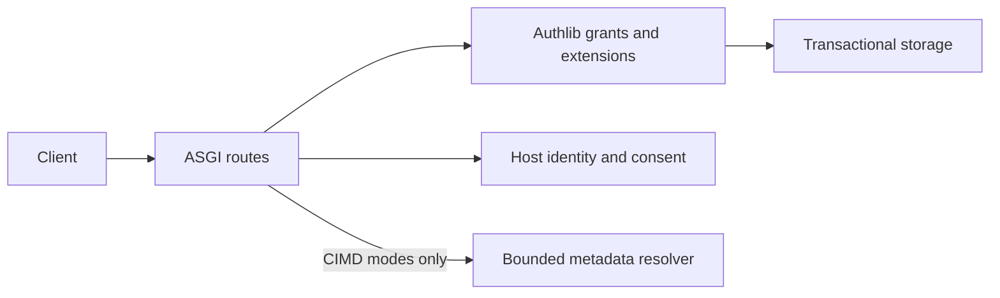

# Integrate with your application

[← Overview](../README.md) · [Installation](getting-started.md) · [Storage contract](storage.md)

The library embeds Authlib's framework-independent Authorization Server in Starlette or FastAPI. Your host owns login, consent and durable storage; a Resource Server owns HTTP bearer parsing, challenges and application permissions.



## Mount in your application

Supply your application's storage, identity and consent adapters. In this snippet, `storage`, `identity` and `consent` are your implementations of the contracts below:

```python
from fastapi import FastAPI

from oauth21_asgi import AuthorizationServer, ExactRedirectPolicy

app = FastAPI()
oauth = AuthorizationServer(
    issuer="https://auth.example.com/",
    scopes={"read", "write"},
    resources={"https://api.example.com/documents", "https://api.example.com/images"},
    storage=storage,
    identity=identity,
    consent=consent,
    redirect_policy=ExactRedirectPolicy({"https://client.example.com/callback"}),
)
oauth.mount(app)
```

### The three host adapters

- **Identity:** async `authenticate(request)` returns a `Subject` or your login/error response. Synchronous `get_subject(subject_id)` performs a fresh authoritative lookup. A subject carries its stable ID, active state and `authorization_version`; change that version after reset, disable or account recreation.
- **Consent:** `render(request, context, consent_token)` returns your consent page. Escape displayed metadata and include `consent_token` in a POST form to the authorization route. The validated context contains client identity, scopes, exact resource/redirect, state and subject. `decide(request, context)` returns `Decision.ALLOW` or `Decision.DENY`; GET never grants access.
- **Storage:** implement `Storage.transaction()` and `UnitOfWork` for durable, transactional persistence. Read the [storage contract](https://github.com/karusb/oauth21-asgi/blob/main/docs/storage.md) before building an adapter. **`MemoryStorage` is development/single-process only.**

## Public-client flow

Default routes follow this flow:

**Discover → Register (DCR) or use metadata URL (CIMD) → Authorize + consent → Exchange → Refresh or revoke**

### 1. Discover and register

Read `/.well-known/oauth-authorization-server`, then POST JSON to `/oauth/register`:

```json
{
  "client_name": "Example application",
  "redirect_uris": ["https://client.example.com/callback"],
  "token_endpoint_auth_method": "none",
  "grant_types": ["authorization_code", "refresh_token"],
  "response_types": ["code"],
  "scope": "read write"
}
```

The registration response contains a random client ID and no client secret. This profile defaults omitted auth method to `none`, grants to code/refresh and scope to configured scopes. Registration is public; use `registration_hook` and host middleware for rate control. A CIMD client skips registration and uses its validated HTTPS metadata document URL as the client ID.

### 2. Authorize

Send the user to `/oauth/authorize` with `response_type=code`, client ID, exact registered redirect, scope, fresh state, **one** allowlisted resource, a valid S256 challenge and explicit `code_challenge_method=S256`. After login and consent, check callback state and exact `iss` against discovery.

### 3. Exchange the code

Exchange using POST form encoding at `/oauth/token`: `grant_type=authorization_code`, client ID, code, verifier, the same redirect and resource. Verifiers must contain 43–128 permitted characters. Authlib performs PKCE hashing/comparison. Wrong verifier/client/redirect/resource does not consume the code; success does so atomically.

### 4. Refresh or revoke

Refresh at `/oauth/token` with `grant_type=refresh_token`, client ID, refresh token, the same resource and optional narrowed scope. Each rotation replaces both credentials; grant lifetime never slides indefinitely.

> **Serialize refresh requests.** A correctly bound predecessor replay revokes its entire token family, including the successor. Concurrent replay therefore invalidates the newly issued credentials.

Revoke at `/oauth/revoke` with client ID, token and optional `token_type_hint`. Access or refresh revocation invalidates the family; unknown tokens return success. Credentials belong in form bodies, not URL queries or Authorization headers for this public-only profile.

## Resource server integration

Validate a bearer token against the exact resource and required scopes:

```python
principal = oauth.validate_access_token(
    bearer_token,
    resource="https://api.example.com/documents",
    scopes={"read"},
)
```

`None` means reject the credential. `Principal` exposes subject, client, scopes, exact resource, expiry and family ID. Validation rechecks authoritative identity/version. Async hosts should call this synchronous operation through `run_in_threadpool`.

`oauth.revoke_subject(subject_id)` invalidates grants, codes and pending consents. `oauth.prune()` runs storage cleanup. Keep these administrative operations behind host authorization.

MCP hosts can use this package as their Authorization Server while the official MCP SDK owns protected-resource discovery, challenges, tool metadata and request authentication. Installed-wheel tests exercise real TCP, verified HTTPS through Caddy and MCP tool calls in all modes. Local ChatGPT-style DCR/CIMD fixtures cover documented callbacks and public auth-method negotiation; these are compatibility tests, not hosted-client certification.

## Configuration and security

`Limits` configures body/query sizes, the total body-read deadline (`body_timeout`, default 10 seconds), client/code/consent/family capacities, refresh rotation bounds and TTLs. `Paths` configures all endpoint routes. Issuers with path components use RFC 8414 discovery path insertion. Route collisions fail explicitly. `oauth.engine` exposes the real Authlib server for supported public extensions.

`ExactRedirectPolicy` requires safe HTTPS and exact membership. `CallableRedirectPolicy` checks URI safety before applying your predicate. Loopback callbacks require explicit opt-in. Only CIMD-enabled modes fetch metadata; branding and JWKS URLs are never fetched.

Codes/access/refresh credentials are random 256-bit secrets with SHA-256 digests at rest. Clients and resource audiences match exactly. Storage failures fail closed with sanitized internal diagnostics. Active DCR clients are protected from registration-age expiry; successful use updates inactivity tracking. Only Authlib's token-dictionary log event is filtered. Infrastructure must independently redact credentials and callback queries. See [security](../SECURITY.md) and the [storage contract](storage.md).


## Implementation boundaries

Authlib supplies Authorization Code and refresh grants, public-client authentication, PKCE hashing, metadata claims, revocation and issuer-response encoding. This package adds ASGI request adapters, mandatory S256 syntax, exact single-resource binding, client resolution, transaction callbacks and lifetime policies through public Authlib hooks. No upstream protocol implementation is vendored or patched.

CIMD fetching completes asynchronously outside storage transactions. A request-local ContextVar passes the resolved client into synchronous Authlib work and is reset even on errors/cancellation. DCR-only operation does not require aiohttp. Codes and grants retain their client source, preventing cross-mode credential reuse. See [CIMD](cimd.md).

Storage operations run synchronously in worker threads. A normal OAuth error response may intentionally commit replay revocation; unexpected exceptions roll back. Production adapters must satisfy the [transaction contract](storage.md), including real cross-worker serialization. Rendering/deciding consent happens outside storage transactions; completion rechecks current identity and the ticket before issuance.

[Standards coverage](standards.md) records the precise profile and gaps. [Contributing](../CONTRIBUTING.md) describes validation and release mechanics.
